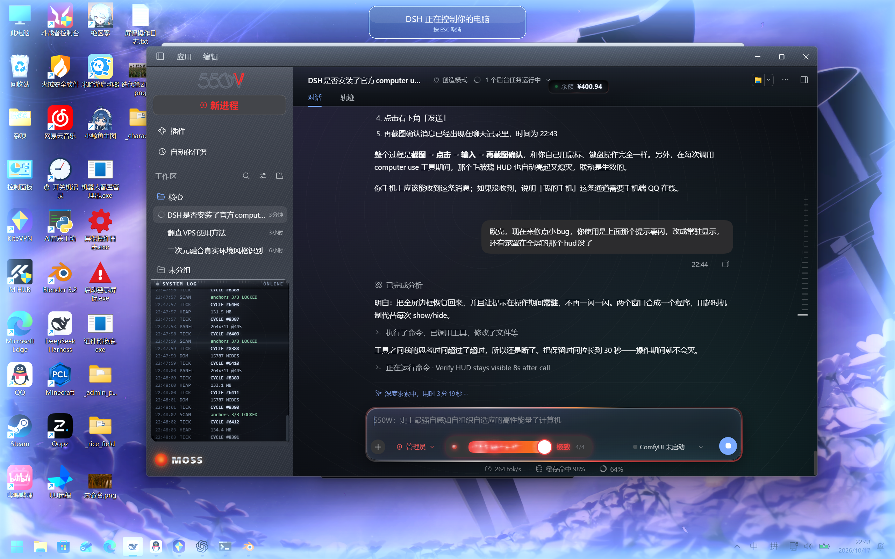

# DSH 管理员模式（dsh-admin-mode）

把「完全访问 + 永不询问」做成 DSH 里的一个权限档，并自带官方 computer use 与屏幕 HUD。



## 功能

- **管理员权限档**：`danger-full-access` + `approval: never`，在权限菜单里和「仅可查看 / 工作区内修改 / 完全权限」并列
- **两次严重警告**：选择时连续弹两次，每次都必须勾选确认才能继续
- **内置 computer use**：官方 `@deepseek-ai/dsh-computer-use` + `cua-driver-native`，无需单独安装
- **屏幕 HUD**：AI 操作电脑时显示全屏淡蓝辉光边框 + 顶部毛玻璃提示块（「DSH 正在控制你的电脑 / 按 ESC 取消」），操作结束 30 秒后自动淡出

## 安装

把本目录作为 bundle 安装到当前 DSH profile：

```bash
dsh plugin install <本仓库路径或 npm 包名>
```

或在 DSH 的插件管理器里用 `install_bundle` 指向该目录。

## HUD 依赖（可选）

HUD 是一个 Python 脚本（Pillow 绘制 + Win32 分层窗口）：

```bash
pip install pillow
```

- 需要 Windows + Python 3.9+
- 用 `DSH_HUD_PYTHON` 环境变量指定解释器路径（默认依次尝试 `pythonw.exe`、`python.exe`）
- 没有 Python 时，权限档和 computer use 照常工作，只是没有屏幕提示

## 安全提示

- 管理员档意味着**完全文件访问 + 永不询问**，请只在你信任的任务里使用
- computer use 是官方 **experimental** 原生驱动，与 DSH 同进程运行，原生崩溃可能带崩 DSH
- HUD 只是视觉提示，不改变权限行为

## 结构

```
index.js            Host 半：启动 HUD、监听 computer-use 工具
client.js           Client 半：权限菜单控件（含两次警告）
cordis.patch.yml    插入权限预设、computer use、客户端控件
hud/cua_hud.py      全屏边框 + 毛玻璃提示块
locale/*.json       插件元数据（中/英）
icon.svg            插件图标
```

## License

MIT
